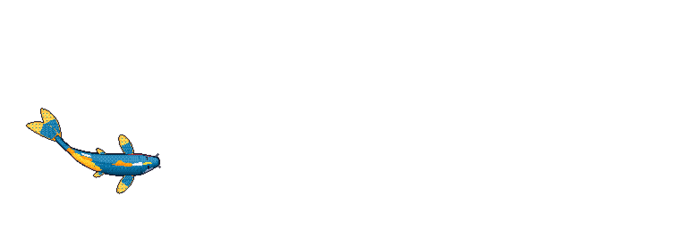

# Hi, I'm Adi

CS @ Cornell · Data Science Intern @ MITRE

I build ML systems end to end, graph neural networks, LLM powered backends, and the infra for them.

## Things I've built

- **[Tauron](https://github.com/adiprathapa/Tauron)** - GNN early-warning system for dairy herd disease. GRU + GraphSAGE over a herd contact graph predicts mastitis, BRD, and lameness 48 hours ahead; gradient-based explanations run 40× faster than GNNExplainer. Built at the Cornell Digital Ag Hackathon.
*PyTorch Geometric · FastAPI · React · D3.js*
- **[Helicity](https://github.com/AI-HackathonNYC/helicity)** - liquidity stress scoring engine over a NetworkX knowledge graph linking stablecoins, banks, and jurisdictions, with a multi-model LLM jury for causal narratives and IPFS-pinned score snapshots for verifiable audit trails.
*FastAPI · React · NetworkX · MCP*
- **[ZAM](https://github.com/adiprathapa/ZAM)** - AI-powered market sizing tool that generates TAM/SAM/SOM scenarios for startup founders. [Live app](https://zam-nu.vercel.app).
*React · Express · MongoDB · Groq*

## Open source

- **Kubeflow** - [merged PRs](https://github.com/kubeflow/trainer/pulls?q=is%3Apr+author%3Aadiprathapa) validating reserved MPI environment variables in TrainingRuntime, plus a Kubeflow SDK fix for the in-cluster Spark Connect URL
- **Jenkins** - [merged PRs](https://github.com/jenkinsci/plugin-installation-manager-tool/pulls?q=is%3Apr+author%3Aadiprathapa) adding a CLI flag for configuring the update center download URL; re-enabled a JUnit test broken since Java 17
- **openZIM** - [contributions](https://github.com/openzim/freecodecamp/pulls?q=is%3Apr+author%3Aadiprathapa) to the FreeCodeCamp-to-ZIM scraper for offline learning
- **CCExtractor** - [test suites](https://github.com/CCExtractor/ccsync/pulls?q=is%3Apr+author%3Aadiprathapa) hardening the ccsync Tasks page UI, covering Reports Toggle behavior and selection state in the multi select utilities

  

---

   

*Feel free to reach out for collaborations or just to say hi!*

